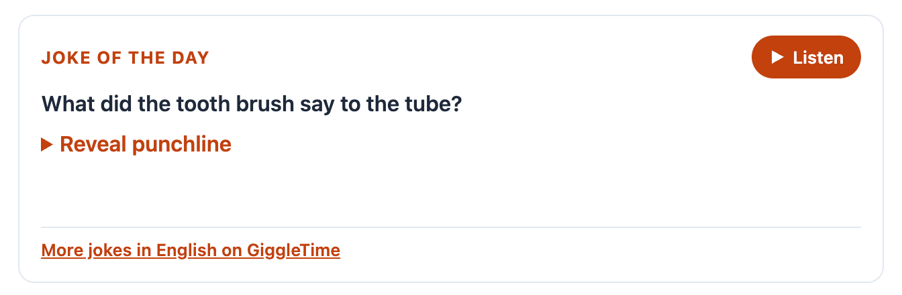
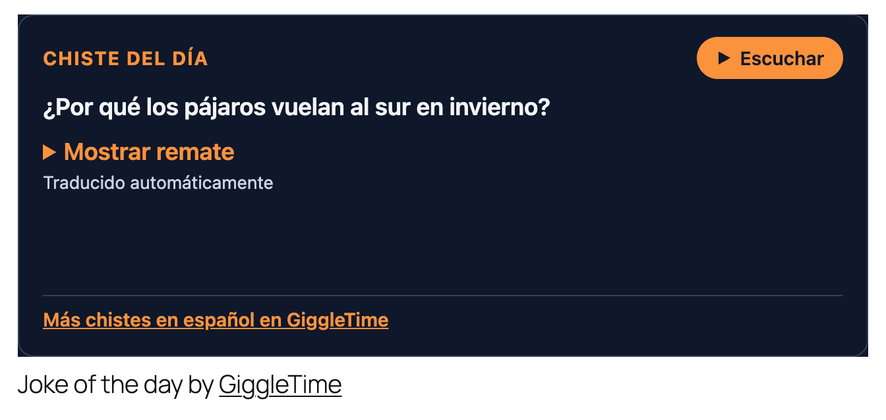

# GiggleTime Joke of the Day widget

A free, family-friendly **joke of the day** for any website, in **26 languages**. Paste one iframe, use the WordPress plugin, or fetch the joke as JSON and style it yourself.

- **Free.** No account, no API key, no sign-up.
- **Family-friendly.** Only jokes that GiggleTime's content filter rates as suitable for all ages.
- **Private.** The widget sets no cookies and loads no third-party scripts, so it doesn't need a cookie banner.
- **Classroom-friendly.** In two-part jokes the punchline stays hidden until someone clicks.
- **26 languages.** English, Spanish, French, German, Italian, Portuguese, Dutch, Polish, Russian, Ukrainian, Arabic, Japanese, Chinese, Hindi and more.

Configurator with a live preview: **https://www.giggletime.app/en/widget**



## 1. Paste an iframe

```html
<iframe src="https://www.giggletime.app/embed/joke?lang=en"
        title="Joke of the Day" width="100%" height="200"
        loading="lazy" style="border:0"></iframe>
<p>Joke of the day by <a href="https://www.giggletime.app/en/home">GiggleTime</a></p>
```

Please keep the small attribution line. That's the only thing we ask.

| Parameter | Values | Default |
|---|---|---|
| `lang` | `en` `ar` `bg` `ca` `cs` `cy` `da` `de` `el` `es` `et` `fr` `hi` `id` `it` `ja` `ka` `nl` `pl` `pt` `ru` `sv` `tr` `uk` `vi` `zh` | `en` |
| `cat` | `animals` `christmas` `everyday-life` `family` `food-and-drink` `school` `money` `programming` `pun` `spooky` `technology` `work` `misc` | all |
| `theme` | `auto` `light` `dark` | `auto` (follows the visitor's dark mode) |
| `size` | `s` (160px) `m` (200px) `l` (260px) | `m` |

Set the iframe's `height` to match the size. Example, Spanish, dark theme, animal jokes:

```html
<iframe src="https://www.giggletime.app/embed/joke?lang=es&cat=animals&theme=dark&size=l"
        title="Chiste del día" width="100%" height="260"
        loading="lazy" style="border:0"></iframe>
```



### Where to paste it

| Platform | How |
|---|---|
| **WordPress** | Use the [plugin](wordpress-plugin/) (block, sidebar widget or `[giggletime_joke]` shortcode), or a Custom HTML block |
| **Google Sites** | Insert > Embed > Embed code, paste, Next, Insert |
| **Notion** | Type `/embed` and paste the iframe's `src` address |
| **Blogger** | Layout > Add a Gadget > HTML/JavaScript |
| **Wix** | Add Elements > Embed Code > Embed HTML |
| **Squarespace** | Add a Code block |
| **Any HTML page** | Paste it where the widget should appear |

## 2. Fetch the JSON

```
GET https://www.giggletime.app/embed/today?lang=fr
```

No key. HTTPS. CORS is open (`Access-Control-Allow-Origin: *`), so you can call it from front-end code.

```json
{
  "date": "2026-11-24",
  "lang": "fr",
  "labels": { "title": "Blague du jour", "reveal": "Révéler la chute" },
  "joke": {
    "id": 108,
    "lang": "fr",
    "rtl": false,
    "setup": "Comment la chouette sait que son mari fait la gueule?",
    "punchline": "Parce qu'Hiboude.",
    "text": "Comment la chouette sait que son mari fait la gueule?\n\nParce qu'Hiboude.",
    "url": "https://www.giggletime.app/fr/jokes/jokes/108/..."
  }
}
```

| Field | Meaning |
|---|---|
| `date` | The day this joke is for. Everyone gets the same joke that day. |
| `labels` | "Joke of the Day" and "Reveal punchline", already translated into `lang`. |
| `joke.setup`, `joke.punchline` | The two parts of a two-part joke. |
| `joke.text` | The whole joke. For one-liners, use this. |
| `joke.rtl` | `true` for right-to-left languages such as Arabic. |
| `joke.url` | The joke's page on GiggleTime, for your attribution link. |
| `joke` | `null` if no joke could be picked; show nothing. |

Responses are cached for a few minutes in the browser and longer at the edge, so you don't need your own cache.

### Examples

- [Plain HTML + JavaScript](examples/vanilla.html)
- [React component](examples/react/JokeOfTheDay.jsx)
- [Vue component](examples/vue/JokeOfTheDay.vue)

## 3. WordPress plugin

[`wordpress-plugin/`](wordpress-plugin/) adds a "Joke of the Day" block, a sidebar widget and a shortcode:

```
[giggletime_joke lang="es" category="animals" theme="dark" size="l"]
```

It's waiting for review in the WordPress plugin directory. Until then, download this folder, zip it and upload it under Plugins > Add New > Upload Plugin. The plugin is GPLv2 or later, like WordPress.

## Want to add your own jokes?

GiggleTime also has an API for **sending** jokes (reviewed by a person, rejections always come with a reason): https://www.giggletime.app/en/joke-api

## License

The examples in this repository are MIT licensed (see [LICENSE](LICENSE)). The WordPress plugin is GPLv2 or later. The jokes themselves belong to GiggleTime and their authors; please show them through the widget or the API with the attribution link, rather than copying them in bulk.
